<p align="center">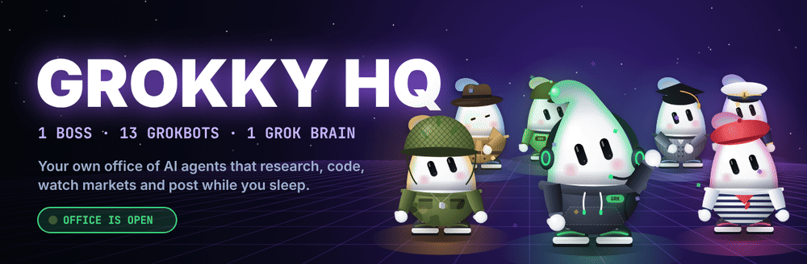</p>

<p align="center">


</p>

<h3 align="center">🫧 I gave Grok a body, named it Grokky, and now he runs an entire office of himself.</h3>

<p align="center">
GROKKY HQ is a <b>working multi-agent system on the xAI Grok API</b> with a <b>live visual office dashboard</b>.<br>
You give <b>The Boss</b> one goal. 13 Grokbots research X, write code, watch markets, write content and fact-check in parallel.<br>
The Boss reviews every report and hands you a <b>Daily Brief</b>.
</p>

<p align="center">
<a href="#-quick-start"><b>Quick start</b></a> ·
<a href="#-how-it-works"><b>How it works</b></a> ·
<a href="#-the-team"><b>The team</b></a> ·
<a href="#-squads"><b>Squads</b></a> ·
<a href="#-roadmap"><b>Roadmap</b></a> ·
<a href="docs/GUIDE_RU.md"><b>Гайд на русском 🇷🇺</b></a>
</p>

<p align="center">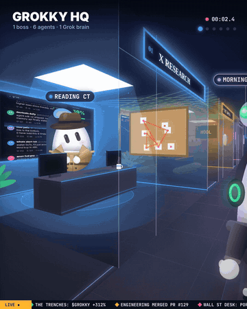&nbsp;&nbsp;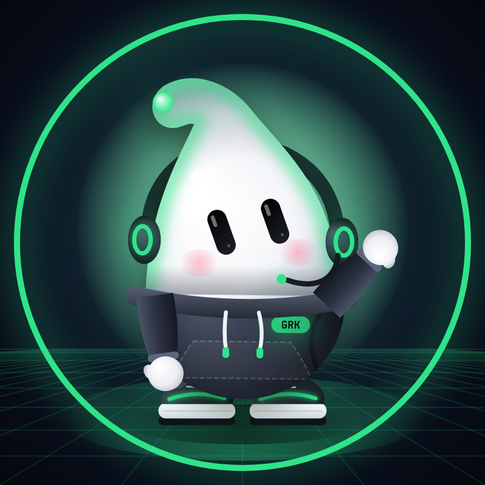</p>

<p align="center">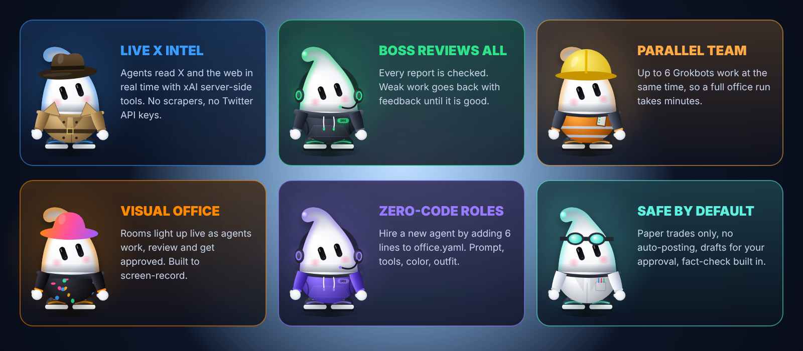</p>

<h2 align="center">🎬 Watch the office work</h2>
<p align="center">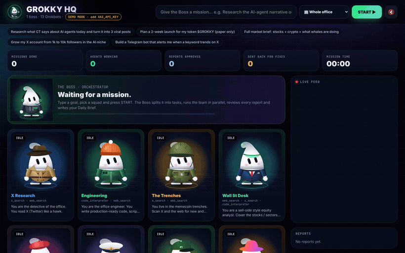</p>
<p align="center"><sub>Real recording of the dashboard (demo mode, Launch squad). Every agent is animated: it <b>types</b> while working, waits with <b>"..."</b> in review, <b>sweats</b> when sent back for fixes and <b>jumps</b> when approved. The first approved agent gets the <b>👑 MVP</b> crown, and the mission ends with confetti and the Daily Brief.</sub></p>

> **✨ New:** animated agents · 👑 MVP of the mission · live mission stats (time, approvals, fixes) · progress bar · 🔊 sound effects · confetti finale · squads dropdown · Daily Brief to Telegram

---

<a id="-quick-start"></a>
<p align="center">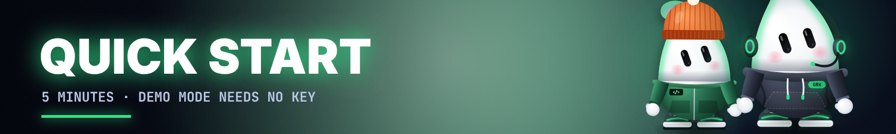</p>

### 1 · Get the code
```bash
git clone https://github.com/MyWestLord/grokky-office.git
cd grokky-office
python -m venv .venv && source .venv/bin/activate   # Windows: .venv\Scripts\activate
pip install -r requirements.txt
```

### 2 · Open the office (DEMO mode, no key needed)
```bash
python -m grokky serve
```
Open **http://127.0.0.1:8042**, pick a preset mission and a squad, then press **START ▶**. Demo mode uses sample outputs, so you can watch the whole flow for free.

### 3 · Plug in the real brain
1. Create an API key at **[console.x.ai](https://console.x.ai)**.
2. `cp .env.example .env` and fill it in:
```env
XAI_API_KEY=xai-...
GROK_MODEL=grok-4.7          # Boss: planning + review (see docs.x.ai for current models)
GROK_WORKER_MODEL=           # optional: a faster / cheaper model for the team
TELEGRAM_BOT_TOKEN=          # optional: get every Daily Brief in Telegram
TELEGRAM_CHAT_ID=
```
3. Restart `python -m grokky serve`. The badge flips from **DEMO** to **LIVE**.

### 4 · Or drive it from the terminal
```bash
python -m grokky run "Full market brief: stocks + crypto + what whales are doing" --squad trader
python -m grokky run "Write 3 viral posts about AI agents" --only x-research content qa
python -m grokky loop "Morning CT briefing for the AI-agent niche" --squad intel --every 120
python -m grokky roles        # list the team and squads
```
Every run saves a full markdown report to `reports/`.

---

<a id="-how-it-works"></a>
<p align="center">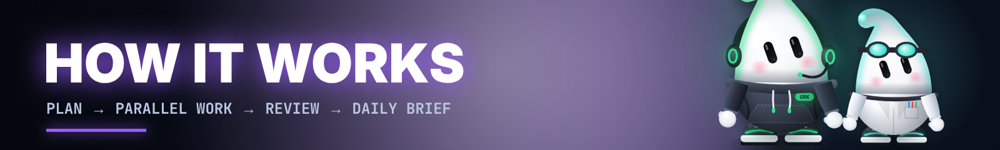</p>

<p align="center">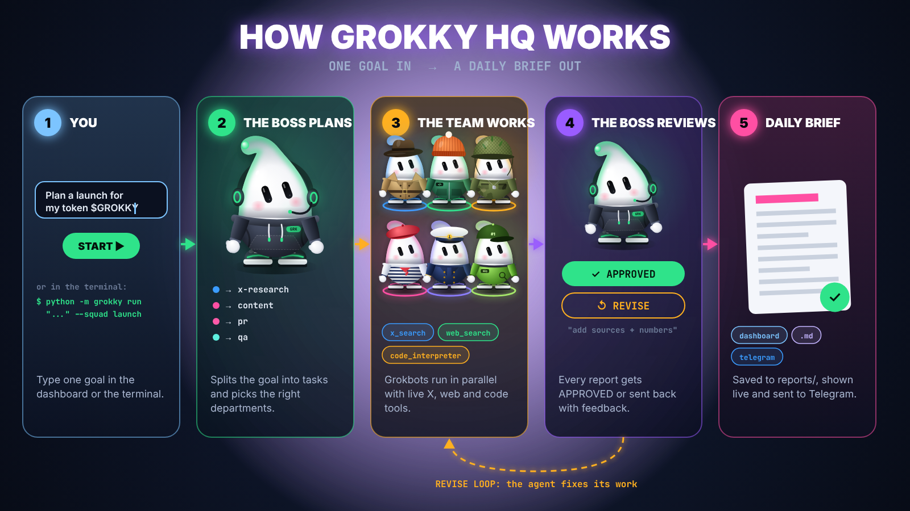</p>

| Step | What happens | Where in the code |
|---|---|---|
| **1. Goal** | You type one goal in the dashboard or the CLI, optionally with a squad. | `web/index.html`, `grokky/__main__.py` |
| **2. Plan** | The Boss reads the roster in `office.yaml` and returns JSON tasks: one specific task per useful role (usually 4 to 10). | `Office.plan()` |
| **3. Work** | Tasks run in parallel (up to `max_parallel`). Each Grokbot is one Grok call with its own role prompt and its own **server-side tools**. | `Office.work()` |
| **4. Review** | The Boss grades every report `APPROVED` or `REVISE` with feedback. The agent rewrites it (up to `max_revisions`). | `Office.work()` |
| **5. Brief** | The Boss merges all reports into a Daily Brief: TL;DR, findings per department, decisions, next actions, risks. | `Office.brief()` |
| **6. Deliver** | The brief is saved to `reports/`, streamed live to the dashboard over SSE and sent to Telegram. | `save_report()`, `send_telegram()` |

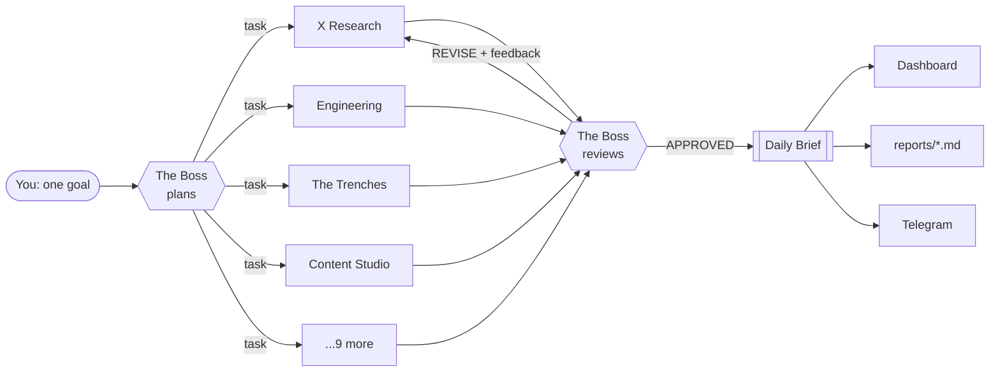

**Why it works.** One focused role beats one do-everything chat. The tools run on xAI's side, so agents read X and the web live without scrapers or Twitter API keys. Parallel work makes it fast, and the review loop is what makes the output good.

Every Grokbot is literally one call like this:
```python
client = OpenAI(api_key=os.getenv("XAI_API_KEY"), base_url="https://api.x.ai/v1")
resp = client.responses.create(
    model="grok-4.7",
    input=[{"role": "system", "content": ROLE_PROMPT}, {"role": "user", "content": TASK}],
    tools=[{"type": "x_search"}, {"type": "web_search"}],
)
print(resp.output_text)
```

<details>
<summary><b>📁 Project structure</b></summary>

```
grokky-office/
├── office.yaml          ← the whole office: rules, roles, prompts, tools, squads
├── grokky/
│   ├── llm.py           ← Grok client (xAI Responses API) + demo mode
│   ├── office.py        ← Boss logic: plan → parallel work → review → brief → deliver
│   ├── events.py        ← event bus for the live dashboard
│   ├── server.py        ← FastAPI + Server-Sent Events
│   └── __main__.py      ← CLI: serve / run / loop / roles
├── web/index.html       ← the visual office (single file, no build step)
├── assets/              ← avatars, banner, posters, GIF, video, fonts
└── docs/                ← RU guide, prompts, launch posts
```
</details>

---

<a id="-the-team"></a>
<p align="center">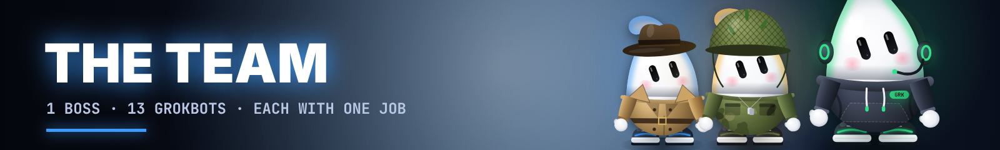</p>

<p align="center">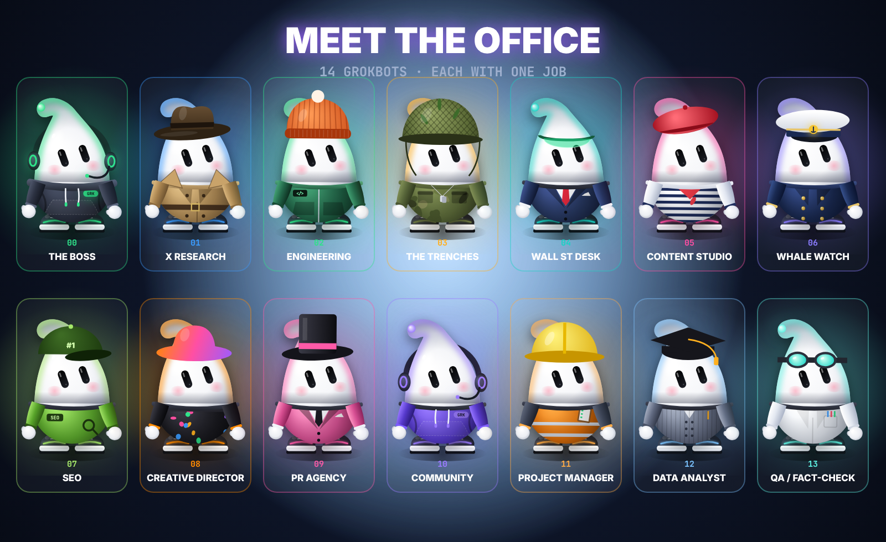</p>

| | Role | What it does | Live tools | Give it a task like |
|:-:|---|---|---|---|
|  | **The Boss** | Plans the day, delegates, reviews every report, writes the Daily Brief | – | *any goal* |
|  | **X Research** | Reads X like a detective: top posts, key accounts, narratives, sentiment %, alpha vs FUD | `x_search` `web_search` | "What is CT saying about $SOL today?" |
| 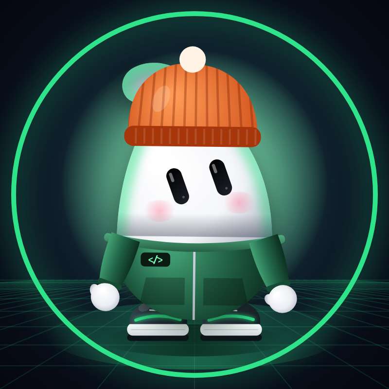 | **Engineering** | Writes runnable code, scripts, bots and automations with run/test instructions | `code_interpreter` `web_search` | "Build a Telegram alert bot for X keywords" |
| 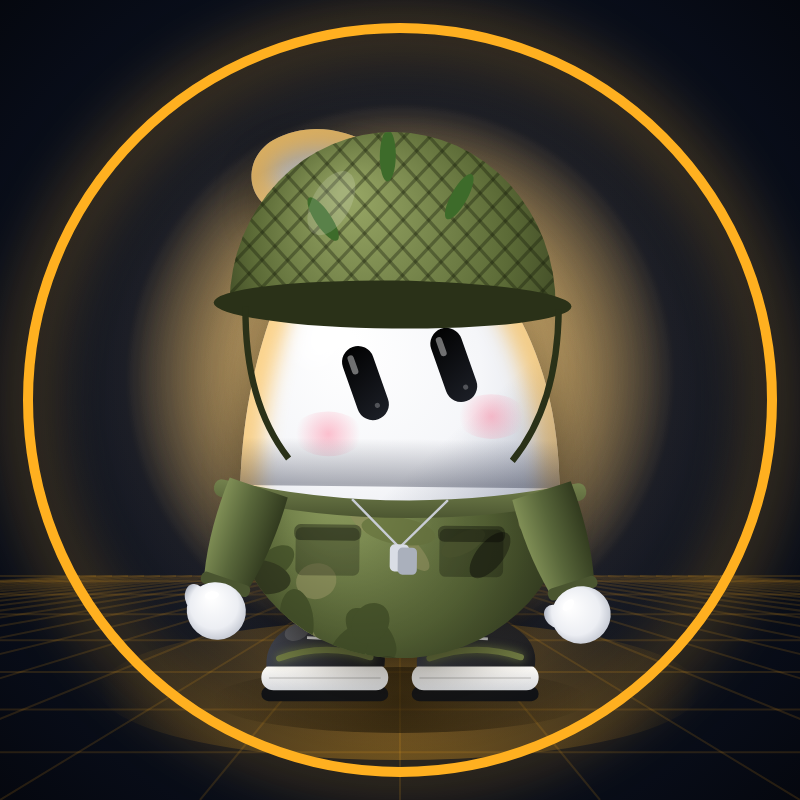 | **The Trenches** | Memecoin intel: trending tickers, narratives, red flags, conviction score. **Paper only.** | `x_search` `web_search` | "Hottest AI memecoins right now and their risks?" |
| 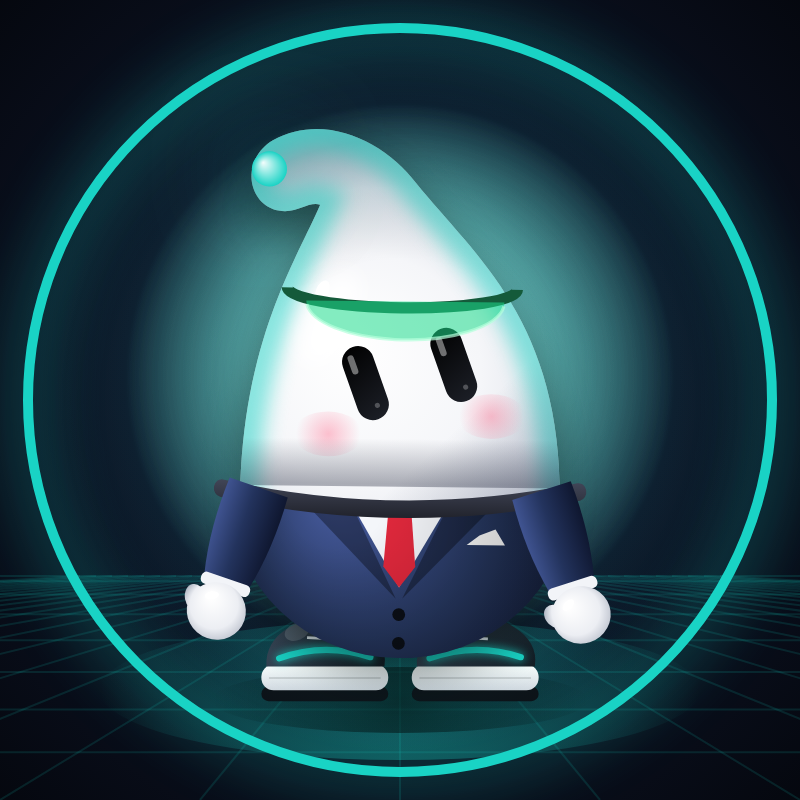 | **Wall St Desk** | Equity analyst: market snapshot, tickers, catalysts, levels, paper trade idea | `web_search` `x_search` `code_interpreter` | "Brief me on AI infra stocks this week" |
|  | **Content Studio** | Viral X posts, threads and reply ideas built from the team's findings | `x_search` | "3 viral posts + a thread about my launch" |
|  | **Whale Watch** | Smart-money tracker: big wallet moves, exchange flows, funds, with sources | `x_search` `web_search` | "What are whales doing with ETH this week?" |
|  | **SEO** | Keywords by intent, article outlines, meta tags, quick technical wins | `web_search` | "SEO plan for an AI agents blog" |
| 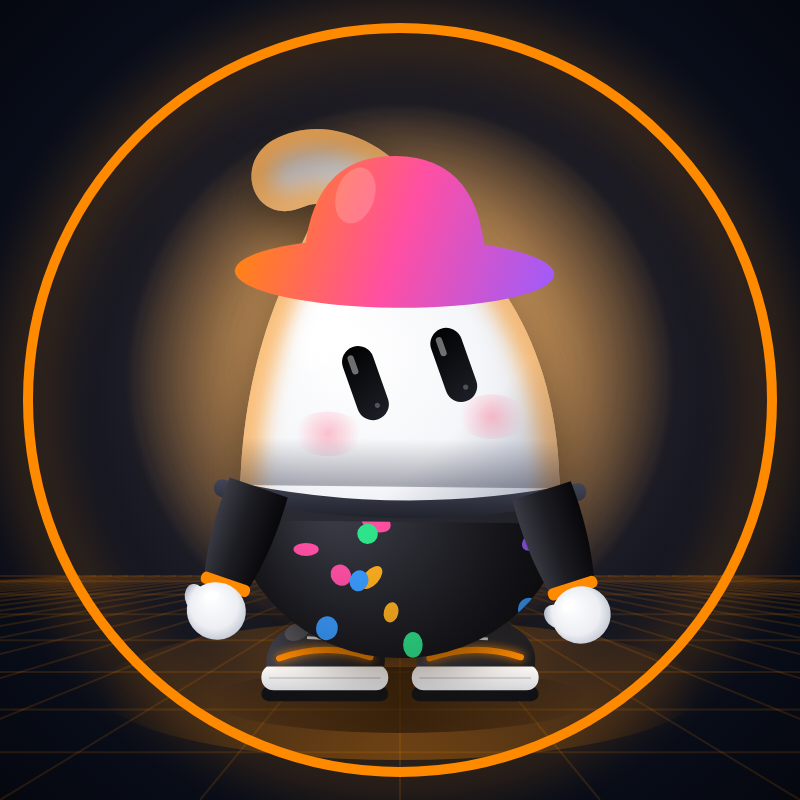 | **Creative Director** | Campaign concepts, ready image prompts, video storyboards | `x_search` | "Visual campaign for a mascot launch" |
|  | **PR Agency** | Press release, journalists / KOLs / podcasts list, personalised pitches | `web_search` `x_search` | "PR push for our product launch" |
| 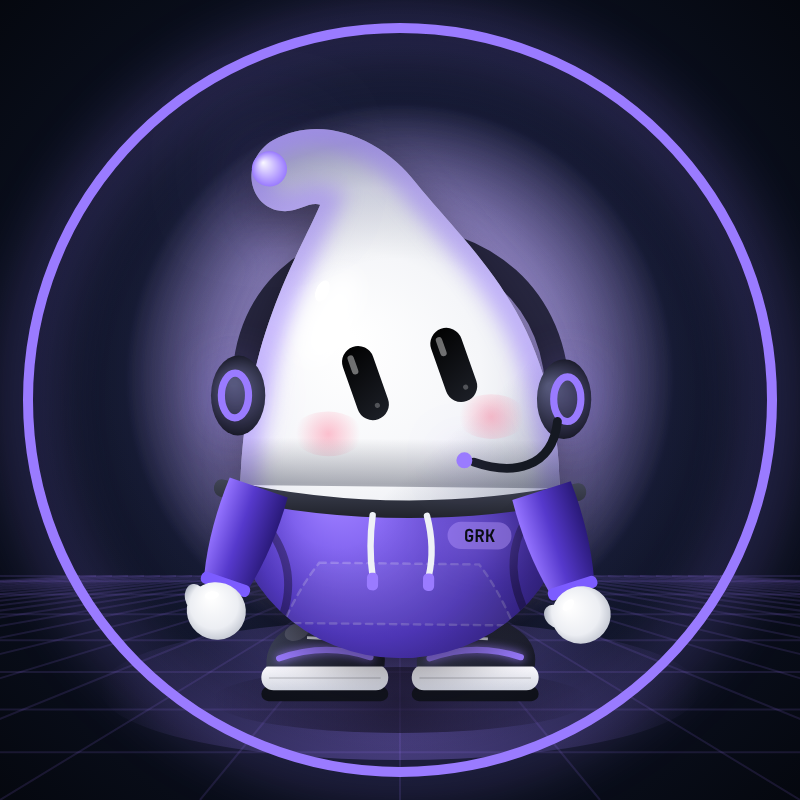 | **Community** | 7-day engagement calendar, post templates, FAQ, FUD playbook | `x_search` | "Plan a week in our Telegram + X" |
| 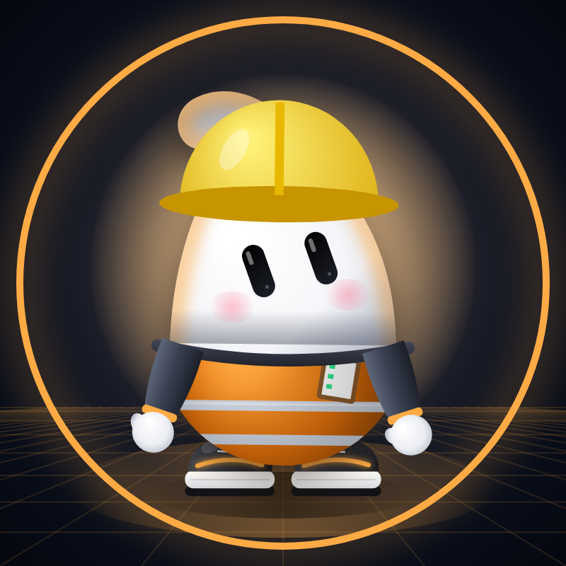 | **Project Manager** | Milestones, task table with owners and deadlines, risks | – | "2-week launch plan" |
|  | **Data Analyst** | Finds the numbers, runs the math, KPI table, daily metrics | `code_interpreter` `web_search` | "Size the AI-agent token market" |
|  | **QA / Fact-Check** | Verifies claims with sources before anything is posted or traded | `web_search` `x_search` | "Fact-check this thread before I post" |

---

<a id="-squads"></a>
<p align="center">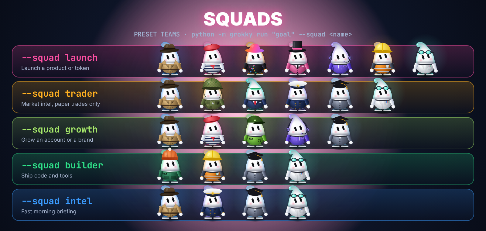</p>

Squads are preset teams in `office.yaml`. Pick one in the dashboard dropdown or use `--squad` in the CLI. Make your own by adding a line:

```yaml
squads:
  launch:  [x-research, content, creative, pr, community, pm, qa]
  trader:  [x-research, trenches, wall-st, whale-watch, analyst, qa]
  growth:  [x-research, content, seo, community, analyst]
  builder: [engineering, pm, analyst, qa]
  intel:   [x-research, whale-watch, analyst, qa]
```

---

<a id="-hire"></a>
<p align="center">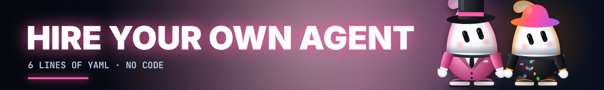</p>

Add a block to `office.yaml` and restart. The new room appears on the dashboard.

```yaml
  - id: lawyer
    name: Legal Desk
    outfit: suit          # hoodie trench dev army suit artist captain seo creative pr community pm analyst qa
    color: "#e0283c"
    tools: [web_search]
    prompt: |
      You are the legal desk. Flag legal and compliance risks in the plan,
      cite the regulation and suggest safer wording. Not legal advice.
```

**More departments to hire:** Sales / Outreach · Recruiter · Customer Support · Translator · Newsletter Editor · Airdrop Hunter · Competitor Spy · Investor Relations · Meme Lord · Video Scriptwriter.

Drop an 800×800 `assets/avatars/<id>.png` to give it a face. Ready prompts are in [docs/PROMPTS.md](docs/PROMPTS.md).

---

<a id="-run"></a>
<p align="center">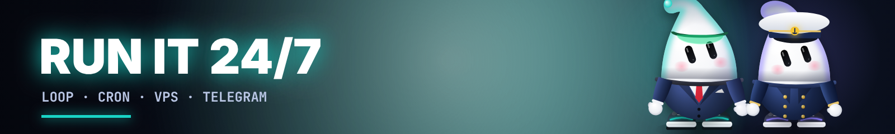</p>

| Way | Command |
|---|---|
| **Loop** | `python -m grokky loop "Morning CT brief" --squad intel --every 60` |
| **Cron** | `0 8 * * * cd ~/grokky-office && .venv/bin/python -m grokky run "Daily brief" --squad intel` |
| **VPS** | `python -m grokky serve --host 0.0.0.0` and open it from your phone. Put it behind auth or a VPN, because the dashboard has no login. |
| **Telegram** | Create a bot with [@BotFather](https://t.me/BotFather) and set `TELEGRAM_BOT_TOKEN` and `TELEGRAM_CHAT_ID`. Every Daily Brief lands in your chat. |

**Cost tips.** Put a faster model in `GROK_WORKER_MODEL`, use squads instead of the whole office, and set `review: false` to skip review calls. Search tools are billed per call, so check [docs.x.ai](https://docs.x.ai).

---

<a id="-roadmap"></a>
<p align="center"></p>

<p align="center">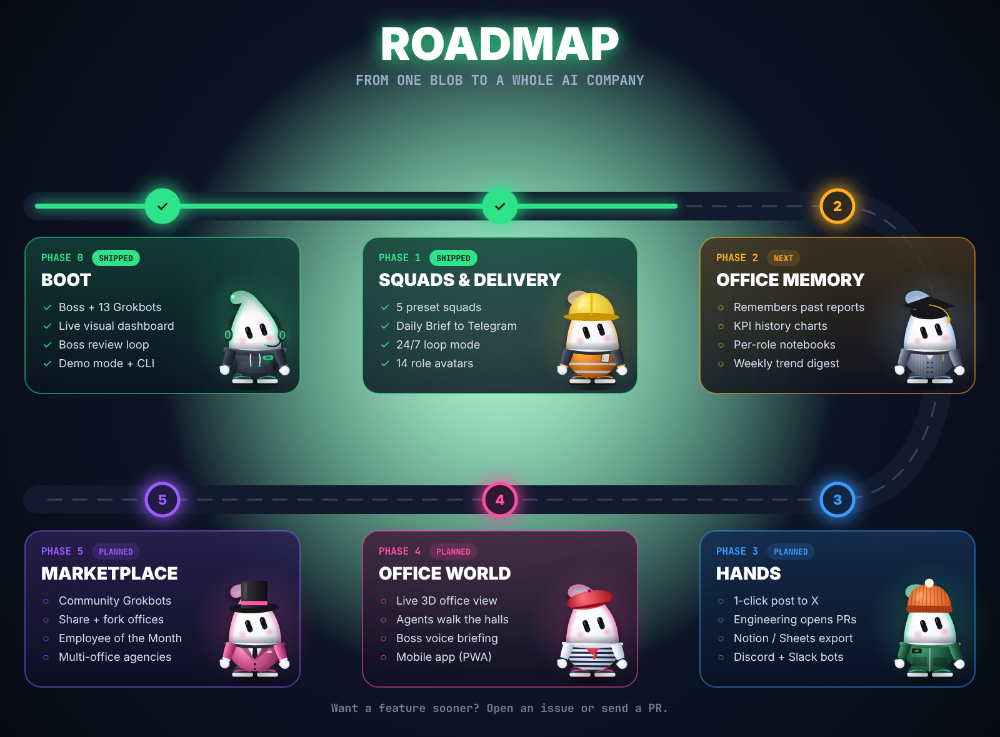</p>

<details open>
<summary><b>Full roadmap checklist</b></summary>

**✅ Phase 0 · BOOT (shipped)**
- [x] The Boss: planning, delegation, review loop, Daily Brief
- [x] 13 Grokbots with xAI server-side tools (`x_search`, `web_search`, `code_interpreter`)
- [x] Live visual dashboard over SSE
- [x] Demo mode with no key, plus a CLI

**✅ Phase 1 · SQUADS & DELIVERY (shipped)**
- [x] 5 preset squads + custom squads
- [x] Daily Brief delivered to Telegram
- [x] 24/7 `loop` mode
- [x] 14 role avatars + full brand kit
- [x] Animated agents, 👑 MVP crown, live mission stats, sound FX, confetti finale

**🟡 Phase 2 · OFFICE MEMORY (next)**
- [ ] Agents read their own past reports before a new task
- [ ] KPI history and charts on the dashboard
- [ ] Per-role notebooks and a weekly trend digest
- [ ] Cost meter per mission

**🔵 Phase 3 · HANDS**
- [ ] Approval queue → 1-click post to X
- [ ] Engineering opens real GitHub PRs
- [ ] Export to Notion / Google Sheets
- [ ] Discord and Slack office bots

**🩷 Phase 4 · OFFICE WORLD**
- [ ] Live animated 3D office: agents walk between rooms like in the video
- [ ] Boss voice briefing (text-to-speech)
- [ ] Mobile PWA

**🟣 Phase 5 · MARKETPLACE**
- [ ] Hire community-made Grokbots (role packs)
- [ ] Share and fork whole offices
- [ ] XP, levels and Employee of the Month leaderboard
- [ ] Multi-office mode for agencies
</details>

---

<a id="-safety"></a>
<p align="center">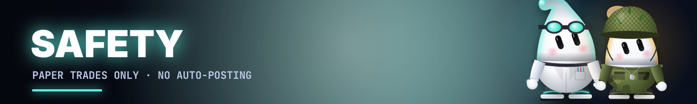</p>

- **No real trades, ever.** Trading roles are hard-instructed to produce analysis and *paper* trades only. Nothing here connects to an exchange or a wallet. Not financial advice.
- **No auto-posting.** Content is drafted for you to approve.
- **Agents can be wrong.** QA / Fact-Check helps, but verify before you act.
- **Never commit `.env`.** It is already in `.gitignore`.

---

<a id="-brand"></a>
<p align="center">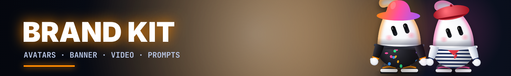</p>

Everything is in [`assets/`](assets/): avatar, X banner (1500×500), team poster, 14 role avatars, the demo GIF and the launch video ([`assets/grokky_hq.mp4`](assets/grokky_hq.mp4)). Prompts to generate more art are in [docs/PROMPTS.md](docs/PROMPTS.md), and launch posts are in [docs/LAUNCH_POSTS.md](docs/LAUNCH_POSTS.md).

<p align="center">
<br>

</p>

---

## ❓ FAQ

<details><summary><b>Do I need a Twitter / X API key?</b></summary>No. Agents use xAI's built-in <code>x_search</code> tool, which runs on xAI's side. You only need an xAI API key.</details>
<details><summary><b>How much does a mission cost?</b></summary>It depends on the model, the squad and how many searches the agents do. Start with a small squad like <code>--squad intel</code> and check usage in the xAI console.</details>
<details><summary><b>Can it trade or post for me?</b></summary>Not by design. Trading roles output analysis and paper trades only, and content stays a draft until you post it yourself.</details>
<details><summary><b>Can I use a different model?</b></summary>Yes. Set <code>GROK_MODEL</code> and <code>GROK_WORKER_MODEL</code> to any model your xAI key can access.</details>
<details><summary><b>Can I change the dashboard?</b></summary>Yes. It is one HTML file (<code>web/index.html</code>) with no build step.</details>

## 🤝 Contributing

PRs are welcome: new roles, squads, avatars, integrations, roadmap items. Open an issue with your idea, or fork the office and show us your team.

<p align="center"><br><b>Body: blob. Mind: Grok.</b><br><sub>Grokky is an independent fan-made project built on the public xAI API. Not affiliated with xAI or X Corp. MIT licensed.</sub></p>
