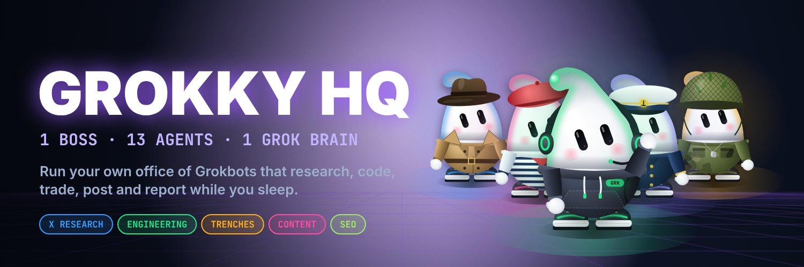
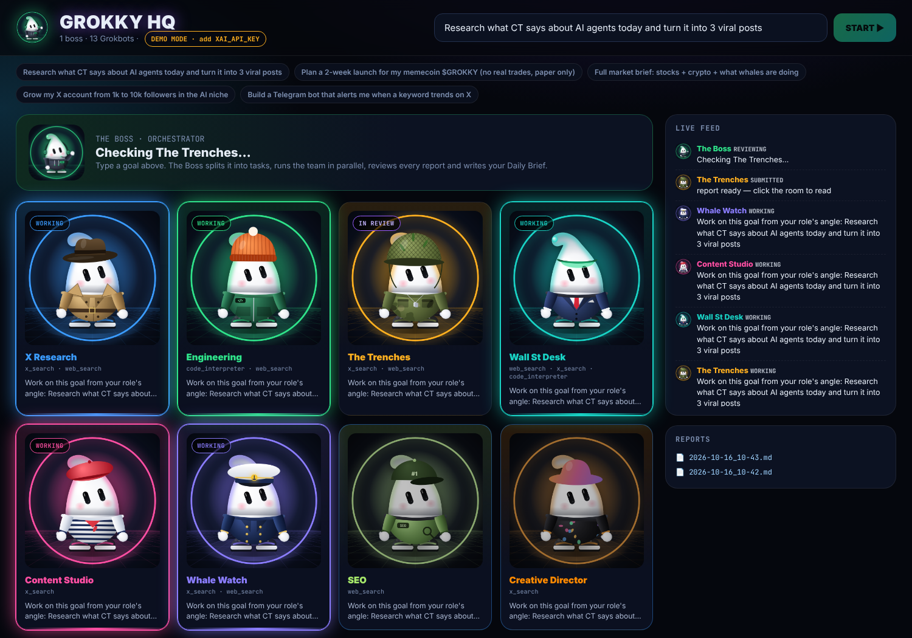
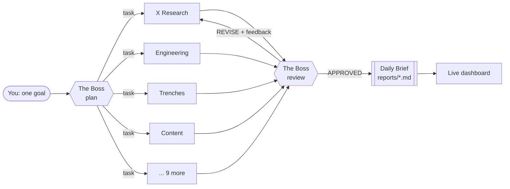

<p align="center"></p>

<h1 align="center">GROKKY HQ</h1>
<p align="center"><b>Run your own office of Grokbots.</b><br>
One Boss, 13 AI agents and one Grok brain. They research X, write code, watch markets, post content and report back while you sleep.</p>

<p align="center">
<a href="#-quick-start-5-minutes">Quick start</a> ·
<a href="#-the-team">The team</a> ·
<a href="#-how-it-works">How it works</a> ·
<a href="#-hire-your-own-agent">Hire your own agent</a> ·
<a href="docs/GUIDE_RU.md">Гайд на русском 🇷🇺</a>
</p>

<p align="center"> &nbsp; </p>

---

## What is this?

**GROKKY HQ** is a working multi-agent system built on the **xAI Grok API** plus a live visual office dashboard.

You give **The Boss** one goal, for example *"research what CT says about AI agents and plan a launch"*. Then:

1. 🧠 **The Boss plans.** It splits your goal into concrete tasks and assigns them to the right departments.
2. ⚡ **The team works in parallel.** Each Grokbot is a Grok call with its own role prompt and its own **live tools**: `x_search` (real-time X/Twitter), `web_search` and `code_interpreter`.
3. ✅ **The Boss reviews every report.** It sends back `APPROVED` or `REVISE` with feedback, and the agent fixes its work.
4. 📄 **You get a Daily Brief.** A clean markdown report is saved to `reports/` and shown on the dashboard.

Everything is visible live: rooms light up when an agent is working, go purple during review and turn green when approved.

<p align="center"></p>

---

## 🚀 Quick start (5 minutes)

**1. Get the code**
```bash
git clone https://github.com/MyWestLord/grokky-office.git
cd grokky-office
python -m venv .venv && source .venv/bin/activate   # Windows: .venv\Scripts\activate
pip install -r requirements.txt
```

**2. Try it right now in DEMO mode (no key needed)**
```bash
python -m grokky serve
```
Open **http://127.0.0.1:8042**, pick a preset mission and press **START**. Demo mode uses fake outputs, so you can see the whole office flow for free.

**3. Turn on the real brain**
- Create an API key at **[console.x.ai](https://console.x.ai)**.
- `cp .env.example .env` and paste it in:
```env
XAI_API_KEY=xai-...
GROK_MODEL=grok-4.7          # boss: planning + review (see docs.x.ai for current models)
GROK_WORKER_MODEL=           # optional: a faster/cheaper model for the team
```
Restart `python -m grokky serve`. The badge switches from **DEMO** to **LIVE**.

**4. Or run it from the terminal**
```bash
python -m grokky run "Full market brief: stocks + crypto + what whales are doing"
python -m grokky run "Write 3 viral posts about AI agents" --only x-research content qa
python -m grokky loop "Morning CT briefing for the AI-agent niche" --every 120   # every 2 hours
python -m grokky roles
```

---

## 👥 The team

<p align="center"></p>

| | Role | What it does | Live tools | Try it with |
|---|---|---|---|---|
|  | **The Boss** | Plans the day, delegates, reviews every report, writes the Daily Brief | – | *any goal* |
|  | **X Research** | Reads X like a detective: top posts, key accounts, narratives, sentiment %, alpha vs FUD | `x_search` `web_search` | "What is CT saying about $SOL today?" |
|  | **Engineering** | Writes runnable code, scripts, bots and automations with run/test instructions | `code_interpreter` `web_search` | "Build a Telegram alert bot for X keywords" |
|  | **The Trenches** | Memecoin intel: trending tickers, narratives, red flags, conviction score. **Paper only.** | `x_search` `web_search` | "What are the hottest AI memecoins right now?" |
|  | **Wall St Desk** | Equity analyst: market snapshot, tickers, catalysts, levels, paper trade idea | `web_search` `x_search` `code_interpreter` | "Brief me on AI infra stocks this week" |
|  | **Content Studio** | Viral X posts, threads and reply ideas built from the team's findings | `x_search` | "3 viral posts + a thread about my launch" |
|  | **Whale Watch** | Smart-money tracker: big wallet moves, exchange flows, funds, with sources | `x_search` `web_search` | "What are whales doing with ETH this week?" |
|  | **SEO** | Keywords by intent, article outlines, meta tags, quick technical wins | `web_search` | "SEO plan for an AI agents blog" |
|  | **Creative Director** | Campaign concepts, ready image prompts, video storyboards | `x_search` | "Visual campaign for a mascot launch" |
|  | **PR Agency** | Press release, list of journalists / KOLs / podcasts, personalised pitches | `web_search` `x_search` | "PR push for our product launch" |
|  | **Community** | 7-day engagement calendar, post templates, FAQ, FUD playbook | `x_search` | "Plan a week in our Telegram + X" |
|  | **Project Manager** | Milestones, task table with owners and deadlines, risks | – | "2-week launch plan" |
|  | **Data Analyst** | Finds the numbers, runs the math, KPI table, daily metrics | `code_interpreter` `web_search` | "Size the AI-agent token market" |
|  | **QA / Fact-Check** | Verifies claims with sources before anything is posted or traded | `web_search` `x_search` | "Fact-check this thread before I post" |

> The Boss only assigns the roles a goal actually needs, usually 4 to 10 per mission. Use `--only` to force a specific squad.

---

## 🧠 How it works



| File | What's inside |
|---|---|
| `office.yaml` | **The whole office.** Office rules, every role, its prompt, color, outfit and tools. Edit this, not the code. |
| `grokky/llm.py` | Grok client (xAI **Responses API**, OpenAI-compatible, `https://api.x.ai/v1`) plus demo mode |
| `grokky/office.py` | Boss logic: plan → parallel work → review loop → brief → save report |
| `grokky/server.py` | FastAPI dashboard + live events over Server-Sent Events |
| `web/index.html` | The visual office (single file, no build step) |
| `assets/` | Avatars, banner, team poster, GIF, video |

Every agent is one call like this. The tools run on xAI's side, so there are no scrapers or Twitter API keys to manage:

```python
client = OpenAI(api_key=os.getenv("XAI_API_KEY"), base_url="https://api.x.ai/v1")
resp = client.responses.create(
    model="grok-4.7",
    input=[{"role": "system", "content": ROLE_PROMPT}, {"role": "user", "content": TASK}],
    tools=[{"type": "x_search"}, {"type": "web_search"}],
)
print(resp.output_text)
```

---

## 🧩 Hire your own agent

Add a block to `office.yaml` and restart. That's it.

```yaml
  - id: lawyer
    name: Legal Desk
    outfit: suit          # hoodie, trench, dev, army, suit, artist, captain, seo, creative, pr, community, pm, analyst, qa
    color: "#e0283c"
    tools: [web_search]
    prompt: |
      You are the legal desk. Flag legal and compliance risks in the plan,
      cite the regulation, and suggest safer wording. Not legal advice.
```

Ideas for more departments: **Sales / Outreach**, **Recruiter**, **Customer Support**, **Translator**, **Newsletter Editor**, **Airdrop Hunter**, **Competitor Spy**, **Investor Relations**, **Meme Lord**, **Video Scriptwriter**.

To give a new role an avatar in the same style, drop an 800×800 PNG named `<id>.png` into `assets/avatars/`. See [docs/PROMPTS.md](docs/PROMPTS.md) for ready prompts.

---

## ⏰ Run it 24/7

- **Simple:** `python -m grokky loop "Morning CT brief" --every 60`
- **Cron (Linux/macOS):** `0 8 * * * cd ~/grokky-office && .venv/bin/python -m grokky run "Daily brief" >> office.log 2>&1`
- **Server:** run `python -m grokky serve --host 0.0.0.0` on any small VPS and open the dashboard from your phone. Put it behind auth or a VPN, because the dashboard has no login.

## 💸 Cost tips

- Set `GROK_WORKER_MODEL` to a faster/cheaper Grok model and keep the smart one for the Boss.
- Use `--only` to run just the squad you need.
- Set `review: false` in `office.yaml` to skip review calls.
- Search tools are billed per call on xAI, so check [docs.x.ai](https://docs.x.ai) pricing.

## ⚠️ Safety

- **No real trades, ever.** Trading roles are hard-instructed to produce analysis and *paper* trades only. Nothing in this repo connects to an exchange or a wallet. Not financial advice.
- **No auto-posting.** Content is drafted for you to approve. If you wire up posting, keep a human in the loop.
- Agents can be wrong. QA / Fact-Check helps, but verify before you act.
- Never commit your `.env`.

## 🎨 Brand kit

Avatar, banner, team poster, 14 role avatars, demo GIF and the launch video are all in [`assets/`](assets/). Prompts to generate more are in [docs/PROMPTS.md](docs/PROMPTS.md), and launch post templates are in [docs/LAUNCH_POSTS.md](docs/LAUNCH_POSTS.md).

<p align="center"><br><i>Body: blob. Mind: Grok.</i></p>

---

Grokky is an independent fan-made project built on the public xAI API. It is not affiliated with xAI or X Corp. MIT licensed.
